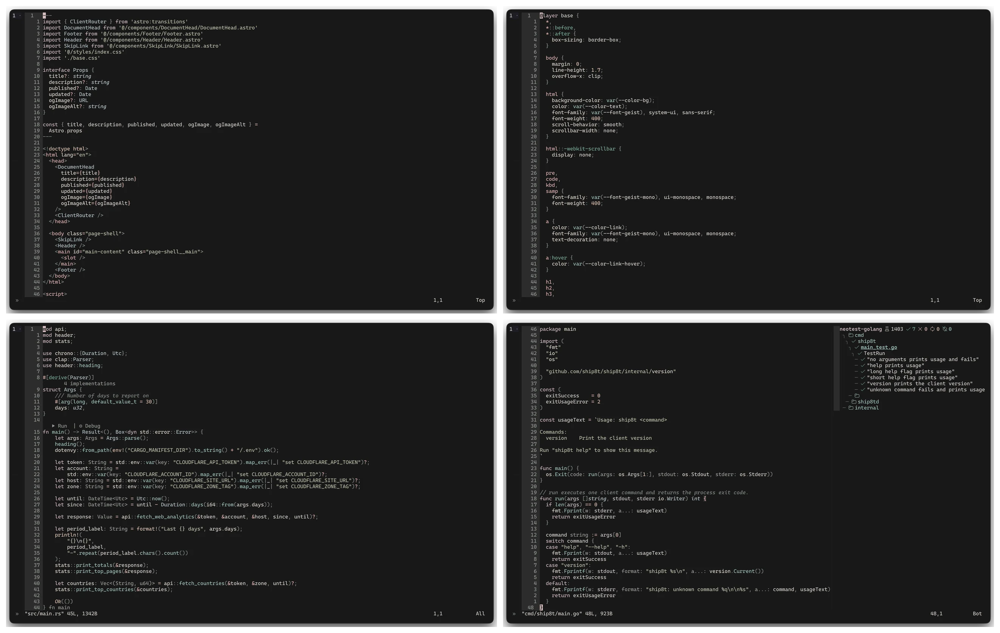

# kasumi.nvim 💮

A Neovim colorscheme written in Lua, with a muted palette of dusty pinks,
sages and greys on a near-black background.



## Features

- Editor, syntax, Treesitter and LSP semantic token highlights
- Plugin highlights for gitsigns, nvim-cmp, telescope,
  nvim-treesitter-context, nvim-dap, neotest, mason, kulala and vim-dadbod-ui
- The 16 terminal colors set inside Neovim, so `:terminal` matches the theme
- Matching themes for Ghostty, WezTerm, tmux and zsh, in [extras](#extras)

## Installation

With `vim.pack`, the plugin manager built into Neovim 0.12 and newer:

```lua
vim.pack.add({ 'https://github.com/ryanjayleyva/kasumi.nvim' })
vim.cmd.colorscheme('kasumi')
```

With [lazy.nvim](https://github.com/folke/lazy.nvim):

```lua
{
  'ryanjayleyva/kasumi.nvim',
  lazy = false,
  priority = 1000,
  config = function()
    vim.cmd.colorscheme('kasumi')
  end,
}
```

## Options

Call `setup` before loading the colorscheme. These are the defaults:

```lua
require('kasumi').setup({
  -- Use the terminal background instead of the theme background
  transparent = false,
})
```

### Transparent background

Set `transparent = true` before loading the colorscheme.

With `vim.pack`:

```lua
vim.pack.add({ 'https://github.com/ryanjayleyva/kasumi.nvim' })
require('kasumi').setup({ transparent = true })
vim.cmd.colorscheme('kasumi')
```

With lazy.nvim:

```lua
{
  'ryanjayleyva/kasumi.nvim',
  lazy = false,
  priority = 1000,
  config = function()
    require('kasumi').setup({ transparent = true })
    vim.cmd.colorscheme('kasumi')
  end,
}
```

The editor, winbar and selected tab then use your terminal's background, so
set the opacity or blur in the terminal itself. Floating windows, the
statusline and the treesitter-context bar stay opaque.

## Palette

The editor colors reuse the base colors where they can. Only the
backgrounds and the soft foreground are new.

### Base colors (ANSI 0-15)

These also set the `:terminal` colors inside Neovim. The tables below are
generated from `lua/kasumi/palette.lua` by `scripts/build-extras.lua`.

<!-- palette:start -->

| Index | Name       | Color                                     |
| ----- | ---------- | ----------------------------------------- |
| 0     | black      |       |
| 1     | rose       |        |
| 2     | sage       |        |
| 3     | blush      |       |
| 4     | aqua       |        |
| 5     | mauve      |       |
| 6     | jade       |        |
| 7     | grey       |        |
| 8     | charcoal   |    |
| 9     | rose_light |  |
| 10    | cream      |       |
| 11    | peach      |       |
| 12    | mist       |        |
| 13    | lavender   |    |
| 14    | sage_light |  |
| 15    | silver     |      |

### Editor colors

| Role             | Color                                           | Variable      |
| ---------------- | ----------------------------------------------- | ------------- |
| background       |        | ink           |
| background_panel |  | ink_darker    |
| background_popup |  | ink_popup     |
| subtle           |            | charcoal      |
| selection        |         | ink_selection |
| foreground       |        | silver        |
| foreground_soft  |   | ash           |
| foreground_muted |  | grey          |
| border           |            | charcoal      |

<!-- palette:end -->

## Extras

The `extras` folder has the same colors for other tools. Each file starts with
a comment that says where to copy it and what to add to your config.

| Tool                                               | File                                                        |
| -------------------------------------------------- | ----------------------------------------------------------- |
| [Ghostty](https://ghostty.org)                     | `extras/ghostty/kasumi`                                     |
| [WezTerm](https://wezterm.org)                     | `extras/wezterm/kasumi.toml` or `extras/wezterm/kasumi.lua` |
| [tmux](https://github.com/tmux/tmux)               | `extras/tmux/kasumi.tmux`                                   |
| [eza](https://github.com/eza-community/eza) in zsh | `extras/zsh/kasumi-eza.zsh`                                 |
| zsh-syntax-highlighting and zsh-autosuggestions    | `extras/zsh/kasumi-syntax.zsh`                              |

## Contributing

The extras and the palette tables above are generated from
`lua/kasumi/palette.lua`, so edit the palette and never the generated files.
Then run this with Neovim 0.10 or newer:

```sh
nvim -l scripts/build-extras.lua
```

Add `--check` to list any generated file that is out of date without writing.

## License

Released under the [Apache License 2.0](LICENSE).
